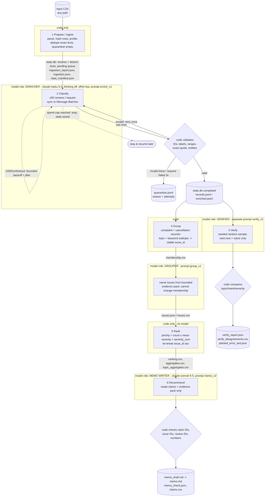

# Architecture

## Who decides what

| Stage | Input | Output | Owner | Failure behavior | Stop condition |
|---|---|---|---|---|---|
| 1 Prepare | input CSV | `state.db`, `ingestion_report.json`, `ingestion.json`, `data_manifest.json` | code | malformed CSV raises; empty text -> quarantine `empty_review_text` | every row read |
| 2 Classify | pending distinct texts (<=50/request) | completed results, `calls.jsonl`, `validation_errors.jsonl` | Haiku 5.5 reads language; code validates and saves after each request | invalid item retried once then quarantined; transient API errors retried 4x with backoff; request failing 3x -> quarantined | no pending texts, Ctrl-C (in-flight saved), or spend cap |
| 3 Verify | seeded sample of completed texts (text only) | verifier predictions, agreement + disagreements, planted-error test | Haiku 5.5 (separate prompt); code compares | missing verifier lines counted, not guessed | sample done |
| 4 Group | completed complaint/cancellation records | `membership.csv`, `issues.json` | code assigns members; Haiku 5.5 only names issues | unparseable/unknown name lines rejected, code default name kept | every complaint in exactly one issue |
| 5 Rank | records + membership | `ranking.csv`, `aggregates.csv` | code only | n/a (deterministic) | sorted table |
| 6 Recommend | claims + aggregates + evidence pack | memo, `memo_check.json` | Sonnet 5.5 writes; code checks; a person reviews | unsupported IDs/numbers flagged | memo check + human review |

The orchestrator (`run.py`) is a fixed sequence: code chooses the next step, owns record accounting, budgets
(`ledger/spend.jsonl`, reserve-before-dispatch), retries, and logs. Models exercise judgment only inside
the four bounded roles above, each with its own prompt file, model/settings, inputs, outputs and call log.
